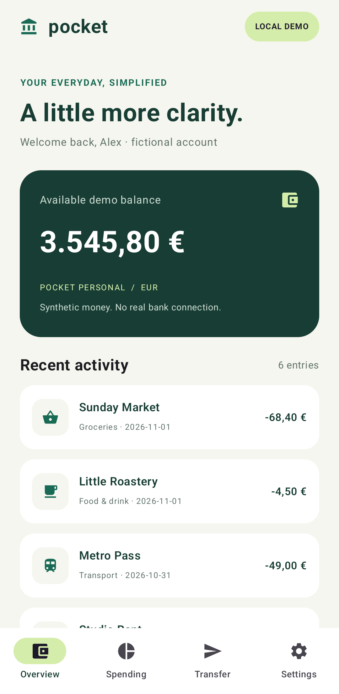
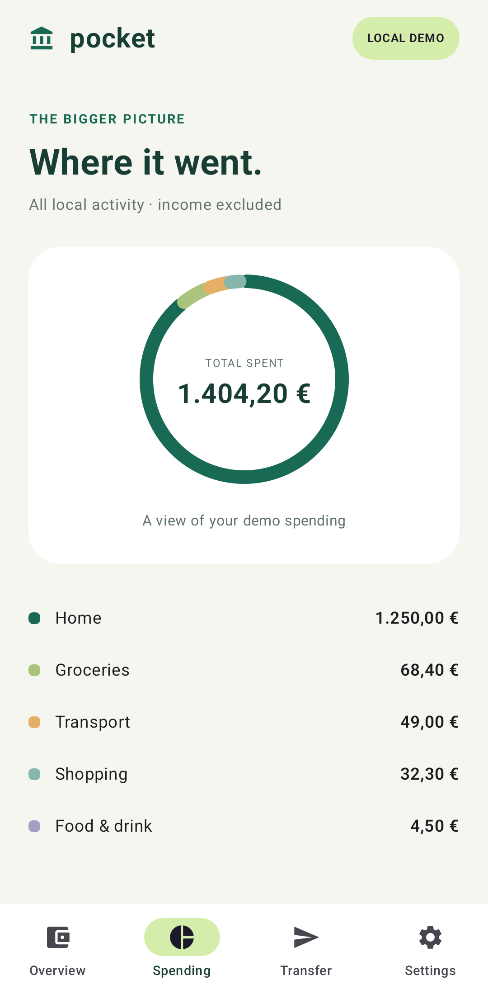
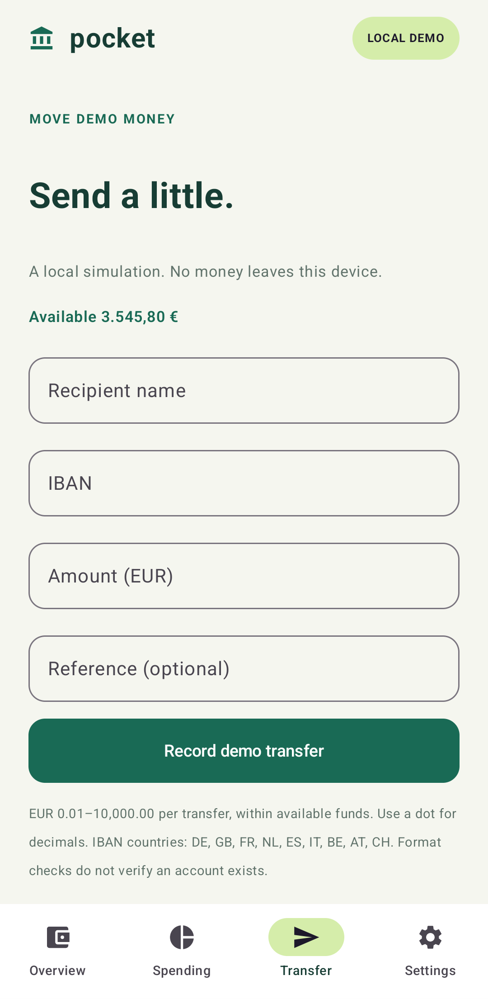

# Pocket Demo · Android banking app

[](https://github.com/hamza2829/android-banking-app/actions/workflows/android.yml)

## What it is

A small native Android account-app demo in Kotlin and Jetpack Compose. **All data is synthetic and local. This is not a real bank and is not connected to any real service.** Transfers only change the local demo ledger. Please use fictional details only.

Account overview and transaction details, an accessible Compose Canvas spending chart, a validated transfer form, and settings with optional device authentication. No Docker is needed.

## Results

**[CI passed on 2 November 2026](https://github.com/hamza2829/android-banking-app/actions/runs/41440307570)** for code commit [`bd92182`](https://github.com/hamza2829/android-banking-app/commit/bd92182aac57989af3d75d11ecb7591dc44e98d6), using Java 17 and an Android API 34 emulator. Subsequent documentation changes add these results and screenshots.

| Executed suite | Passed / total | Failed | Errors | Skipped |
|---|---:|---:|---:|---:|
| JVM unit tests | 59 / 59 | 0 | 0 | 0 |
| Android instrumented tests | 18 / 18 | 0 | 0 | 0 |
| **Total** | **77 / 77** | **0** | **0** | **0** |

Counts come from the run's original JUnit XML, summarized by [this script](scripts/summarize_tests.py). The [saved JSON summary](docs/ci-results.json) matches the artifact. The real device-PIN BiometricPrompt enable/unlock/disable and background-lock flow passed; fingerprint/face sensor success was not tested.

Download `debug-apk`, `test-reports`, and `screenshots-api34` from the [successful run's artifacts](https://github.com/hamza2829/android-banking-app/actions/runs/41440307570#artifacts). There are exactly **3 screenshots**, captured from the running app on the emulator and visually inspected; these are not mockups.

| Account overview | Spending summary | Transfer form |
|---|---|---|
|  |  |  |

Earlier failures are retained in the [verification record](docs/verification.md): local unit tests initially had **2 failures out of 59**, one CI run failed before tests during SDK setup, and the first emulator run had **1 failure out of 18** plus missing screenshot export. All were corrected before the successful run above. No failures or skipped tests remain in that run.

## How it works

- Kotlin, Compose Material 3, MVVM, manual application-scoped dependency injection, coroutines and Flow. Account and transfer ViewModels own UI state. UI collects state with lifecycle awareness.
- Room is the source of truth. Six fictional entries are seeded only into an empty database. The initial EUR 3,545.80 balance equals EUR 2,500.00 opening funds plus the displayed income and expenses. Transfers atomically debit and insert an entry; concurrent attempts cannot overdraw. Data persists across restarts.
- Money uses integer cents, never floating-point arithmetic. Transfer amounts must be EUR 0.01–10,000.00, have at most two decimal places, and fit the current balance. Names are 2–60 trimmed characters and references at most 140. The IBAN check normalizes spaces/case and checks the nine supported country lengths and MOD-97. It does not verify a real account.
- Spending sums all negative entries by category, including local transfers, and excludes income/refunds. The chart covers all stored activity; category amounts are also rendered as text.
- Retrofit's mock snapshot endpoint is exercised with a local MockWebServer in JVM and Room integration tests. The installed app seeds Room directly, without starting a server or making a request. Non-loopback API endpoints are rejected.
- A meaningless local session token is encrypted using EncryptedSharedPreferences and an Android Keystore backed key. Optional BiometricPrompt screen lock permits strong biometrics or a secure device PIN. See [security boundaries](docs/security.md), including unencrypted Room data and security-crypto deprecation.

## What is NOT done

- Synthetic data only; no real bank API or external service.
- No PSD2, real payments, account verification, remote login, synchronization, or recovery.
- No production security review, independent audit, or regulatory compliance claim.
- Not on Google Play. This is a debug demonstration, not a production banking product.
- No encrypted Room database or biometric hardware/sensor verification.

## How to run locally

Open this directory in Android Studio, select JDK 17, install Android SDK 35, and let Gradle sync. Run `app` on an Android 9 / API 28 or newer emulator or device. Gradle 8.11.1 and AGP 8.9.1 are pinned, with a distribution checksum. The first build requires internet access for public dependencies; the app runs offline.

```sh
./gradlew assembleDebug
./gradlew testDebugUnitTest
./gradlew connectedDebugAndroidTest
```

On Windows, use `gradlew.bat` instead of `./gradlew`. The APK is `app/build/outputs/apk/debug/app-debug.apk`.

For all instrumented tests, use a **disposable emulator**, API 34 in CI. Configure the public test PIN before running (never change the PIN of your personal device for this test):

```sh
adb shell locksettings set-pin 1234
adb shell settings put system screen_off_timeout 1800000
adb shell wm dismiss-keyguard
./gradlew connectedDebugAndroidTest
mkdir -p evidence/screenshots
adb pull /sdcard/Download/pocket-demo-screenshots/. evidence/screenshots/
python3 scripts/summarize_tests.py --require-complete
```

The device-credential test is skipped if no secure lock is configured; the summary script treats missing/skipped tests, failures, and missing screenshots as incomplete verification. The PIN test expects `1234`. Fingerprint/face success needs separate manual hardware testing. Screenshots are captured by the actual app instrumentation test, not mockups.

Reports: `app/build/reports/tests/testDebugUnitTest/`, `app/build/reports/androidTests/connected/`, and `evidence/test-summary.json`. The CI workflow uses `reactivecircus/android-emulator-runner` on API 34 and uploads artifacts even when verification fails.
